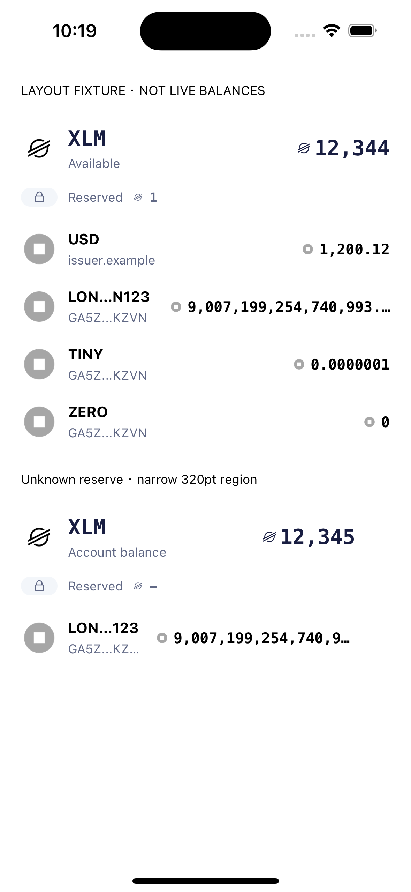
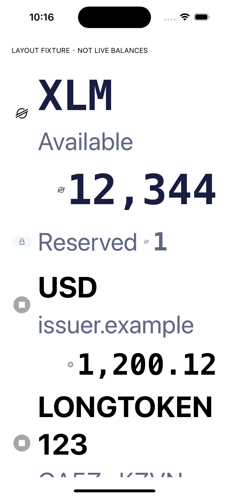

# S05/S06 Home asset-row alignment — developer validation

Base: main `f3e4ae1d8293ef3bf446ef1946d97f1f056e197c`.
Scope: Home asset-row presentation; clean-room Adapt from the pinned visible
behavior described in `../behavior-specs/home-token-list-presentation.md`.
Home remains within its existing strict architecture scope; no maturity upgrade.

## Automated evidence

- Full `npm run check` passed: **263 suites / 2449 tests**, typecheck,
  product-flow script checks, formatting, lint,
  module aliases, architecture, provenance, artwork, locales and unit tests.
- Focused cases cover significant decimal precision above Number's safe range,
  tiny/zero amounts, original issuer/balance accessibility and tap identities,
  cached-domain/address fallback, optional Home image sizes, and large-text
  reflow. Domain completion without an image updates subscribers; completion
  after privacy revocation cannot publish a new revision.
- Both Android and iOS production JS bundles include the new local XLM symbol.
  Bundling verifies resolution/packaging, not rebuilt native binaries.

Final command outcomes and exact remote HEAD are recorded on the PR after push.

## Native component-layout evidence (2026-11-11)

Existing installed Debug app, iPhone 15 Pro / iOS 17.2 Simulator. An isolated
Metro port rendered the actual PinnedNativeAssetRow and AssetList under
AppThemeProvider, with clearly labeled static fixtures and a fake icon port.
The helper did not create AppServices, read Realm/signers or contact providers.
No wallet data was changed. Command-line bundle-host override was process-local.
The helper/service was removed/stopped and the simulator font category restored
from accessibility-extra-extra-extra-large to its original `large` value.

- Normal text: available XLM plus grouped lock/reserve; domain and issuer
  subtitles, exact tiny/zero amounts, long amount truncation, and a 320pt region
  with honest unknown reserve were visually inspected.
- Maximum accessibility text: the original single-line layout over-truncated
  identities/amounts. The implemented reflow puts amounts on their own line,
  allows wrapping and preserves full XLM/USD identities and balances in the
  inspected first viewport. Lower content remains in the fixture ScrollView.
- Fixture screenshots are retained in `evidence/home-token-row-ios-normal.png`
  and `evidence/home-token-row-ios-large-text.png`.

These are native **component-layout fixture** observations, not end-to-end
Home/product-flow acceptance. Android rendering, real devices, VoiceOver and
TalkBack, complete navigation/focus behavior, dark/image themes and real
provider/offline interaction were not accepted in this slice. Existing Stage 9
iOS device System Auth cancel/retry acceptance remains deferred. No fiat,
LOCKED figures, hidden-balance mode or asset ordering is introduced. Work must
independently review the final remote HEAD; this developer record is not approval.

## Fixture screenshots

